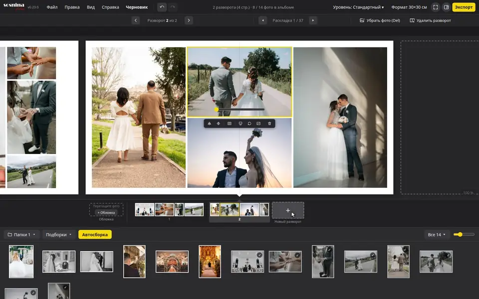
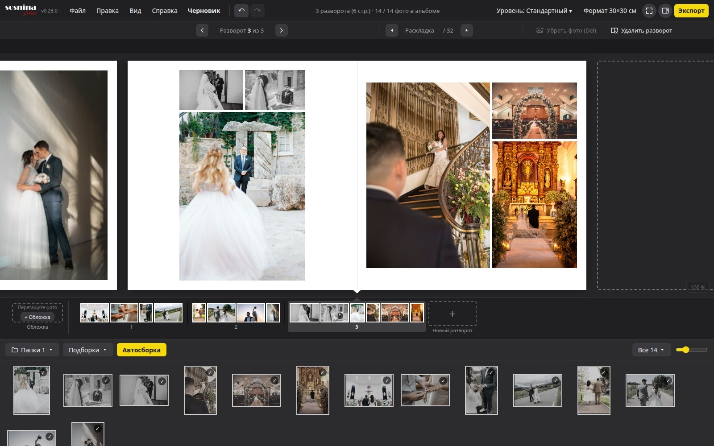

# Sosnina Albums

[](https://github.com/IliaSA101/sosninaalbums/actions/workflows/ci.yml)
[](LICENSE)

**Sosnina Albums** is a desktop application for laying out wedding photo albums, built for a working photographer. Pick folders with photos, drag frames onto spreads (or let auto-assembly do it), flip through layout variants, and export spreads as 300 dpi JPEGs for the print shop. Layouts are computed exactly and **photos are not cropped without your say**: a frame keeps the photo's aspect ratio unless you choose full bleed (crops up to 30 %), crop to fill the sheet (up to 15 %) or set your own crop; margins and gaps are set in millimetres.

- Platform: Windows, macOS, Linux (WebView2, WKWebView, WebKitGTK). Stack: Go 1.26 + [Wails](https://wails.io) v2 + Svelte 5 + TypeScript.
- Status: version 0.24.0, actively developed; the UI is in Russian.
- Built together with photographer Marina Sosnina ([Sosnina films](https://sosnina-films.ru)) and used in her work.



**Auto-build an album and flip through the spreads**

https://github.com/user-attachments/assets/fe756aa5-5faa-49bd-99dd-2e73f1ed7c3f

**Drop photos on a spread and try layout variants**

https://github.com/user-attachments/assets/21096f35-4c1b-4954-b130-9b8cecf1a5b1

Build from source (Go 1.26, Node.js, Wails CLI v2.16):

```
go install github.com/wailsapp/wails/v2/cmd/wails@v2.16.0
wails dev                                                      # dev server with hot reload
powershell -ExecutionPolicy Bypass -File scripts/build.ps1     # release exe in build/bin
powershell -ExecutionPolicy Bypass -File scripts/check.ps1     # gofmt, vet, tests, svelte-check, build
```

License: GPL-3.0-only with an additional term under section 7(b) (modified versions credit the original author in their About window), see [LICENSE](LICENSE) and [NOTICE.md](NOTICE.md). Versions up to 0.22.x were released under MIT. Third-party components: [THIRD_PARTY_NOTICES.txt](THIRD_PARTY_NOTICES.txt). Photos in the clips and on the screenshot are from Pexels (Pexels License, not GPL), authors: [docs/media/CREDITS.md](docs/media/CREDITS.md). Author: [IliaSA101](https://github.com/IliaSA101).

---

## О программе

Sosnina Albums — десктопная программа для вёрстки свадебных фотоальбомов. Рассчитана на фотографа: выбираешь папки со снимками, перетаскиваешь кадры на развороты (или отдаёшь всё автосборке), листаешь варианты раскладки и выгружаешь развороты в JPEG 300 dpi для типографии. Раскладка считается точно, и фото не обрезаются без вашего разрешения: кадр сохраняет пропорции снимка, а обрезку включаете вы — «в край» (до 30 %), «подрезать, чтобы закрыть лист» (до 15 %) или свой кадр фото; поля и промежутки заданы в миллиметрах.

Программу делает Илья Соснин (GitHub: IliaSA101) вместе с фотографом Мариной Сосниной ([Sosnina films](https://sosnina-films.ru)); Марина — первый пользователь и источник требований. Об упоминании и логотипе есть согласие.

## Как это выглядит

**Автосборка альбома и листание разворотов**

https://github.com/user-attachments/assets/fe756aa5-5faa-49bd-99dd-2e73f1ed7c3f

**Фото на разворот и перебор вариантов раскладки**

https://github.com/user-attachments/assets/21096f35-4c1b-4954-b130-9b8cecf1a5b1



## Возможности (0.15.0)

- Библиотека: несколько папок с подпапками, JPEG/PNG, поворот по EXIF, естественная сортировка (`img-9` раньше `img-10`), быстрые миниатюры с дисковым кэшем, пересчёт Adobe RGB в sRGB.
- Автораскладка разворота: перебор деревьев «ряды/столбцы», оценка и до 12 вариантов; переключение пробелом. Режим layflat (фото через корешок) и обычный; фото «в край» (bleed).
- Автосборка альбома из выбранных или ещё не использованных фото: программа сама делит их на развороты; ручка «Разнообразие раскладок» делает соседние развороты непохожими.
- Ручная раскладка: закреплённые места, шаблоны сеток, поворот и зеркало фото, слои, выравнивание, групповое выделение и масштаб группы, карточка X/Y/Ш/В.
- Холст — ряд разворотов, как у SmartAlbums: колесо листает ряд, Ctrl+колесо и щипок меняют масштаб; Alt+щелчок выбирает объект под курсором.
- Перетаскивание мышью: из ленты на разворот, на мини-разворот, между разворотами, обмен местами, перестановка самих разворотов.
- Текст и подписи (33 вшитых шрифта с кириллицей: рукописные, детские, с засечками, без засечек, декоративные), фон разворота и фото на фоне, своя палитра цветов, пустой разворот по «+ Новый разворот».
- Стикеры (45 встроенных и свои PNG/JPEG/SVG) и узоры: галерея фонов, свои фоны в библиотеке программы.
- Круглые места и скругление углов; «Выпрямить по линии» для фото и фона.
- Разнообразие раскладок (0.13): автосборка «от … до …» фото на разворот, серии съёмки, формы «Ленты», «Лесенки», «Ряды», «Фигуры»; Ctrl+колесо — размер миниатюр ленты; фильтр ленты по папкам. Формат файла 9.
- Подписи из таблицы Excel/CSV и из имён файлов; 13 новых видов виньетки, «Копировать оформление».
- Выгрузка для Фотосферы Pro: форматы, обложка по шаблону, папка книги, памятка.
- Обложка альбома, виньетка (окно «Настроить виньетку» с сеткой шаблонов), подписи с полями и именами из списка; двойной щелчок по подписи правит имя под фото на холсте.
- Отмена и возврат (Ctrl+Z / Ctrl+Y), автосохранение через секунду после правки, черновик при первом запуске.
- Фото через корешок (0.15): «Нет», «Только широкие» или «Любые фото»; фильтр семейств раскладок и миниатюры в окне «Автосборка»; обрез и разметка типографии из PSD Фотосферы (подложка с направляющими). Формат файла 11.
- Перенос проекта на другой компьютер: перепривязка недостающих фото.

### Уровни интерфейса

Программа подстраивается под опыт пользователя: **Простой**, **Стандартный**, **Полный** и **Свой** (набор функций выбираешь сам в матрице на стартовом окне). Есть строка меню (Файл, Правка, Вид, Справка, Альбом), линейки в мм и справка по F1 для текущего уровня; на стартовом окне — «Последние» альбомы.

### Формат `.salbum`

Проект — обычный JSON-файл `.salbum`; фото остаются на месте, в проекте лежат только пути. Файл версионируется (старые форматы мигрируют при открытии, файл более новой версии программа не трогает), запись атомарная. Описание — в разделе «Формат `.salbum`» [docs/architecture/salbum-format.md](docs/architecture/salbum-format.md).

### Экспорт

Окно экспорта: диапазон разворотов, выгрузка по страницам или разворотами, качество и dpi (по умолчанию 300). Файлы `01.jpg`, `02.jpg`… с отметкой dpi, профилем sRGB и комментарием; пустые развороты можно выгрузить белыми. Ограничения на размер холста защищают от случайных гигантских файлов.

## Сборка из исходников

Нужно: Go 1.26, Node.js (LTS), Wails CLI v2.16, Windows с WebView2 (есть в Windows 11; на Windows 10 ставится отдельно).

```
go install github.com/wailsapp/wails/v2/cmd/wails@v2.16.0
cd frontend && npm ci && cd ..
wails dev                                                      # разработка; интерфейс ещё и на http://localhost:34115
powershell -ExecutionPolicy Bypass -File scripts/build.ps1     # выпуск: build/bin/SosninaAlbums-<версия>.exe
powershell -ExecutionPolicy Bypass -File scripts/check.ps1     # gofmt, vet, тесты, svelte-check, сборка
```

`check.ps1` понимает флаги `-Go` и `-Ui` (только Go или только фронт) и `-Race`. Порядок выпуска — [docs/RELEASE.md](docs/RELEASE.md). Те же проверки (без Wails) гоняет GitHub Actions: [.github/workflows/ci.yml](.github/workflows/ci.yml).

### Антивирус

Kaspersky (и некоторые другие) ложно срабатывает на свежесобранные Go-exe и блокирует запуск. Добавьте папку проекта в исключения. Временные файлы сборки лучше держать внутри неё: `GOTMPDIR=.gotmp` (папка в `.gitignore`).

### macOS

Собирается на самом Mac: `wails build`. Приложение не подписано, поэтому при первом запуске открывайте его через ПКМ → Открыть. Пошаговая инструкция со снимками экрана для Windows и macOS — [docs/install/guide.md](docs/install/guide.md) (к каждому релизу прикладывается docx); короткие ролики — в [docs/install/video](docs/install/video). Основная платформа — Windows.

## Где лежат данные пользователя

| Что                      | Где                                                                     |
| ------------------------ | ----------------------------------------------------------------------- |
| Лог, настройки, черновик | `%APPDATA%\SosninaAlbums` (`log.txt`, `config.json`, `черновик.salbum`) |
| Кэш миниатюр             | `<UserCacheDir>\SosninaAlbums\thumbs` (на Windows `%LOCALAPPDATA%`)     |

Кэш можно удалять в любой момент, он пересоздастся.

## Структура и документация

- `main.go` — окно Wails; `internal/app` — методы `App` для интерфейса; `internal/layout` — раскладка и автосборка; `internal/album` — модель, правки, файл; `internal/library` — папки, EXIF, миниатюры; `internal/export` — рендер JPEG; `frontend/src` — интерфейс по областям.
- [Структура кода](docs/STRUCTURE.md) — карта папок и файлов.
- [Архитектура](docs/ARCHITECTURE.md)
- [Сборка для macOS](docs/BUILD-macOS.md)
- [История изменений](CHANGELOG.md)
- [План развития](ROADMAP.md)

## Лицензия

GNU GPL версии 3 (только этой версии, GPL-3.0-only) с дополнительным условием по п. 7(b): изменённая версия показывает в окне «О программе» строку «Основано на Sosnina Albums, автор Илья Соснин» и ссылку на этот репозиторий — см. [LICENSE](LICENSE) и [NOTICE.md](NOTICE.md). Версии до 0.22.x включительно выпущены по лицензии MIT; полученные тогда копии остаются под MIT. Встроенные шрифты — SIL Open Font License 1.1, см. [internal/text/fonts](internal/text/fonts/README.md). Остальные зависимости — [THIRD_PARTY_NOTICES.txt](THIRD_PARTY_NOTICES.txt). Фото в роликах и на снимке README — стоковые с Pexels (Pexels License, не GPL), авторы — [docs/media/CREDITS.md](docs/media/CREDITS.md).

## Товарные знаки

Логотип и имя «Sosnina films» принадлежат Марине Сосниной и не входят в лицензию кода. Файлы логотипа: `frontend/src/assets/logo.png` и `build/appicon.png`. При форке замените их своими.
