# Как установить Sosnina Albums

<!-- only: both -->
Программа не требует установки: на Windows это папка из архива, на Mac — одна программа в папке «Программы». Она бесплатная и пока не подписана платным сертификатом Microsoft и Apple. Поэтому при первом запуске система предупредит, что не знает автора. Ниже — как один раз разрешить запуск. Дальше программа открывается как обычно.
<!-- /only -->
<!-- only: windows -->
Программа не требует установки: на Windows это папка из архива `.zip`, в ней файл `.exe`. Она бесплатная и пока не подписана платным сертификатом Microsoft. Поэтому при первом запуске Windows предупредит, что не знает автора. Ниже — как один раз разрешить запуск. Дальше программа открывается как обычно.

Этот файл — для **Windows 10 и 11**. Для Mac есть отдельные файлы (`…-install-guide-macos-…-ru`).
<!-- /only -->
<!-- only: mac -->
Программа не требует установки: на Mac это одна программа в папке «Программы». Она бесплатная и пока не подписана платным сертификатом Apple. Поэтому при первом запуске macOS предупредит, что не знает автора. Ниже — как один раз разрешить запуск. Дальше программа открывается как обычно.
<!-- /only -->
<!-- only: macos -->
Программа не требует установки: на Mac это одна программа в папке «Программы». Она бесплатная и пока не подписана платным сертификатом Apple. Поэтому при первом запуске macOS предупредит, что не знает автора. Ниже — как один раз разрешить запуск для вашей версии macOS (12–26). Дальше программа открывается как обычно.
<!-- /only -->

<!-- only: linux -->
Программа бесплатная и не требует ключей и учётных записей. На Linux её можно поставить пакетом `.deb` (Ubuntu, Linux Mint, Debian) или просто распаковать архив `.tar.gz` и запустить. Платной подписи у файлов нет, поэтому менеджер программ может написать, что пакет не из репозитория: так и есть, это скачанный файл.

Этот файл — для **Linux**. Для Windows и Mac есть отдельные файлы (`…-install-guide-windows-ru`, `…-install-guide-macos-ru`).
<!-- /only -->

<!-- only: 26 -->
<!-- only: mac -->
Этот файл — для **macOS 26 (Tahoe)**. На macOS 12–15 окна другие: возьмите файл со своей версией (`…-install-guide-macos-15-ru`, `…-macos-12-14-ru`).
<!-- /only -->
<!-- /only -->
<!-- only: 15 -->
<!-- only: mac -->
Этот файл — для **macOS 15 (Sequoia)**. На других версиях окна другие: возьмите файл со своей версией (`…-install-guide-macos-26-ru`, `…-macos-12-14-ru`).
<!-- /only -->
<!-- /only -->
<!-- only: 12-14 -->
<!-- only: mac -->
Этот файл — для **macOS 12 (Monterey), 13 (Ventura) и 14 (Sonoma)**: шаги на них одинаковые. Для macOS 15 и 26 окна другие: возьмите файл со своей версией (`…-install-guide-macos-15-ru`, `…-macos-26-ru`).
<!-- /only -->
<!-- /only -->

## Что скачать

Все файлы — на странице выпусков: [github.com/IliaSA101/sosninaalbums/releases](https://github.com/IliaSA101/sosninaalbums/releases/latest).

<!-- only: both -->
Внутри архива — папка «Sosnina Albums <версия>»: программа, эта инструкция и файл «Что нового».

| Компьютер                                         | Файл                                                           |
| ------------------------------------------------- | -------------------------------------------------------------- |
| Windows 10 или 11                                 | `SosninaAlbums-<версия>-windows-x64.zip`                       |
| Mac (M1 и новее, а также Intel), macOS 12 и новее | `SosninaAlbums-<версия>-macos-universal.zip`                   |
| Инструкция                                        | `SosninaAlbums-<версия>-install-guide-ru.docx` (этот документ) |
<!-- /only -->

<!-- only: windows -->
Внутри архива — папка «Sosnina Albums <версия>»: `SosninaAlbums.exe`, эта инструкция и файл «Что нового».

| Что        | Файл                                                                   |
| ---------- | ---------------------------------------------------------------------- |
| Программа  | `SosninaAlbums-<версия>-windows-x64.zip` (Windows 10 или 11)           |
| Инструкция | `SosninaAlbums-<версия>-install-guide-windows-ru.docx` (этот документ) |
<!-- /only -->

<!-- only: macos -->
Внутри архива — папка «Sosnina Albums <версия>»: программа sosninaalbums, эта инструкция и файл «Что нового».

| Что          | Файл                                                                       |
| ------------ | -------------------------------------------------------------------------- |
| Программа    | `SosninaAlbums-<версия>-macos-universal.zip` (M1 и новее, а также Intel)  |
| Инструкция   | `SosninaAlbums-<версия>-install-guide-macos-ru.docx` (этот документ)      |
<!-- /only -->

<!-- only: mac -->
Внутри архива — папка «Sosnina Albums <версия>»: программа sosninaalbums, инструкция и файл «Что нового».

| Что          | Файл                                                           |
| ------------ | -------------------------------------------------------------- |
| Программа    | `SosninaAlbums-<версия>-macos-universal.zip` (M1 и новее, а также Intel) |
| Инструкция   | `SosninaAlbums-<версия>-install-guide-macos-<версия macOS>-ru.docx` (этот документ) |
<!-- /only -->

<!-- only: linux -->
| Что                                | Файл                                                                    |
| ---------------------------------- | ----------------------------------------------------------------------- |
| Пакет (Ubuntu 22.04+, Mint 21+, Debian 12+) | `SosninaAlbums-<версия>-linux-amd64.deb`                         |
| Архив (другие дистрибутивы)        | `SosninaAlbums-<версия>-linux-amd64.tar.gz`                             |
| Инструкция                         | `SosninaAlbums-<версия>-install-guide-linux-ru.docx` (этот документ)   |

Внутри архива — папка «Sosnina Albums <версия>»: программа `sosninaalbums`, значок, эта инструкция, файл «Что нового» и тексты лицензий (`LICENSE`, `NOTICE.md`, `THIRD_PARTY_NOTICES.txt`). Программа рассчитана на процессоры x86-64 (amd64).
<!-- /only -->

<!-- only: win -->
## Windows

Все шаги есть в коротких роликах (без звука). На каждом шаге ролик останавливается, а красная рамка и стрелка показывают, куда нажать:

- распаковать архив (около 25 секунд): [windows-unzip.mp4](https://github.com/IliaSA101/sosninaalbums/raw/v{{VERSION}}/docs/install/video/windows-unzip.mp4);
- первый запуск (около минуты): [windows-start.mp4](https://github.com/IliaSA101/sosninaalbums/raw/v{{VERSION}}/docs/install/video/windows-start.mp4).

Снимки и ролики сделаны на английской Windows, поэтому рядом с русским названием кнопки в скобках стоит английское. На русской Windows окна те же, надписи русские.

### Шаг 1. Скачать

1. На странице выпусков нажмите на файл `SosninaAlbums-<версия>-windows-x64.zip`. Браузер сохранит его в папку «Загрузки».
2. Edge может написать в списке загрузок: «…zip скачивается редко. Перед открытием убедитесь, что доверяете…». Так он встречает все новые файлы без платной подписи. Нажмите у строки файла **«…»** (три точки) → **«Сохранить»**. Если Edge спросит ещё раз, раскройте в окне дополнительные действия и нажмите **«Всё равно сохранить»**.
   ~ **Путь:** Edge → значок загрузок (стрелка вниз справа вверху) → строка файла → **«…»** → **«Сохранить»** → **«Всё равно сохранить»**.

В Chrome и других браузерах так же: в списке загрузок выберите сохранить файл.

### Шаг 2. Распаковать архив

Не запускайте программу прямо из архива: сначала распакуйте его. Это занимает несколько секунд.

1. Откройте папку **«Загрузки»** и дважды щёлкните по файлу `SosninaAlbums-<версия>-windows-x64.zip`: он откроется как обычная папка.
   ~ **Путь:** Проводник → **«Загрузки»** → двойной щелчок по `.zip`.

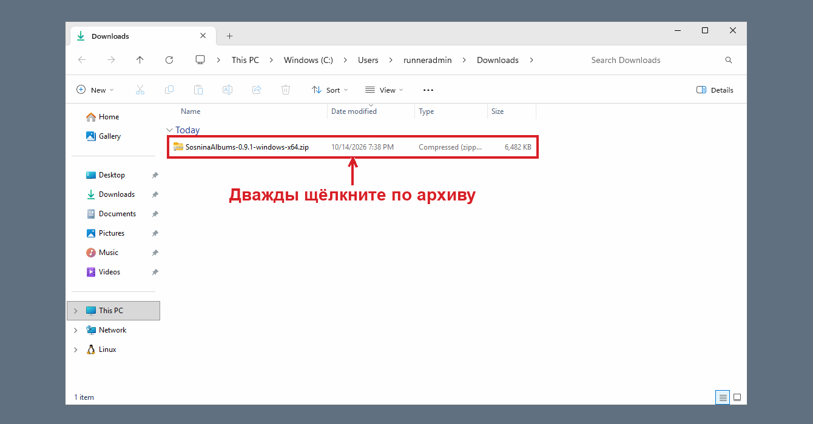

2. Нажмите **«Извлечь все»** (Extract all) на панели над списком файлов. Либо закройте архив, нажмите на файле правой кнопкой мыши и выберите **«Извлечь всё…»**.
   ~ **Путь:** открытый архив → **«Извлечь все»** (Extract all).

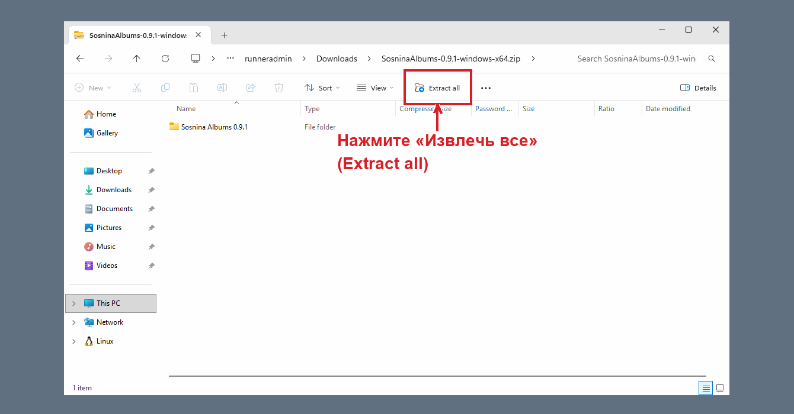

3. В окне выбора папки нажмите **«Извлечь»** (Extract). Откроется папка «Sosnina Albums <версия>»: в ней программа `SosninaAlbums.exe`, инструкция и файл «Что нового».
   ~ **Путь:** окно извлечения → **«Извлечь»** (Extract).

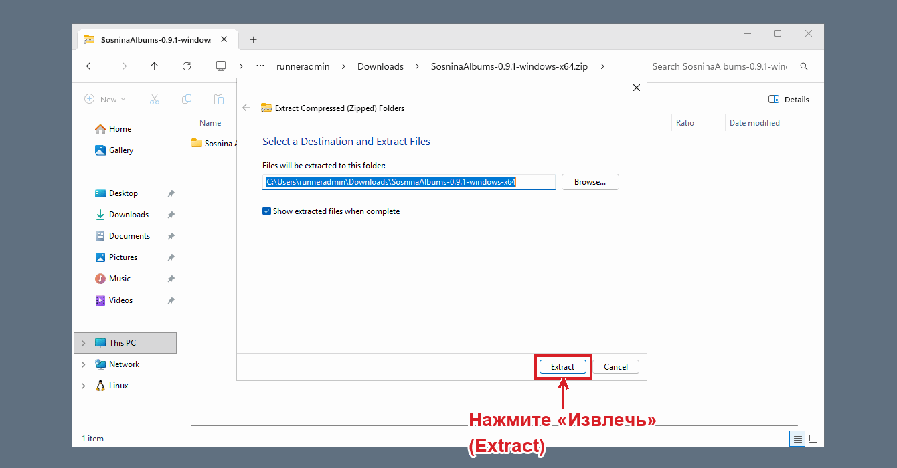

Папку можно переложить в удобное место, например в «Документы».

### Шаг 3. Первый запуск

1. В распакованной папке дважды щёлкните по файлу `SosninaAlbums.exe`.

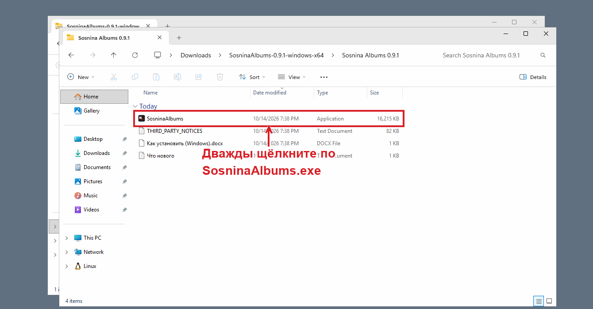

2. Появится синее окно «Система Windows защитила ваш компьютер». Нажмите в нём ссылку **«Подробнее»**.
   ~ **Путь:** двойной щелчок по `.exe` → синее окно SmartScreen → **«Подробнее»**.

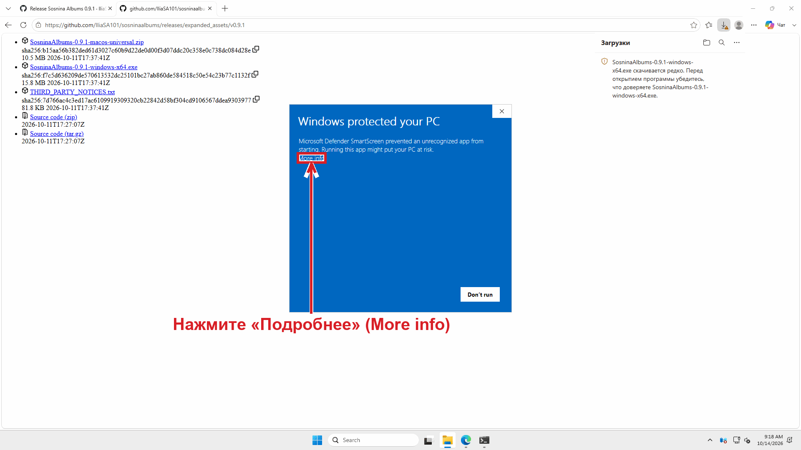

3. Появится кнопка **«Выполнить в любом случае»** — нажмите её. Программа откроется.
   ~ **Путь:** синее окно SmartScreen → **«Подробнее»** → **«Выполнить в любом случае»**.

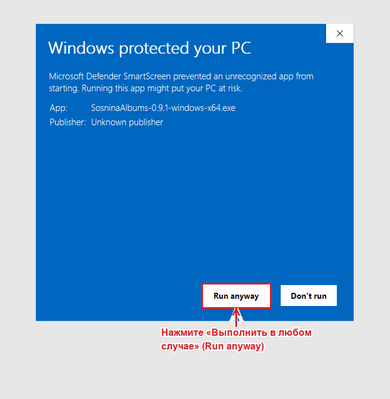

Это окно — фильтр SmartScreen: он предупреждает обо всех новых программах без платной подписи. Спросит он только один раз.

### Если запустили прямо из архива

Если дважды щёлкнуть по `.exe`, не распаковав архив, программа может не запуститься или откроется с предупреждением. В окне «Сжатые ZIP-папки» нажмите **«Извлечь все»** (Extract all) и дальше действуйте как в Шаге 2. Потом запустите файл из распакованной папки.

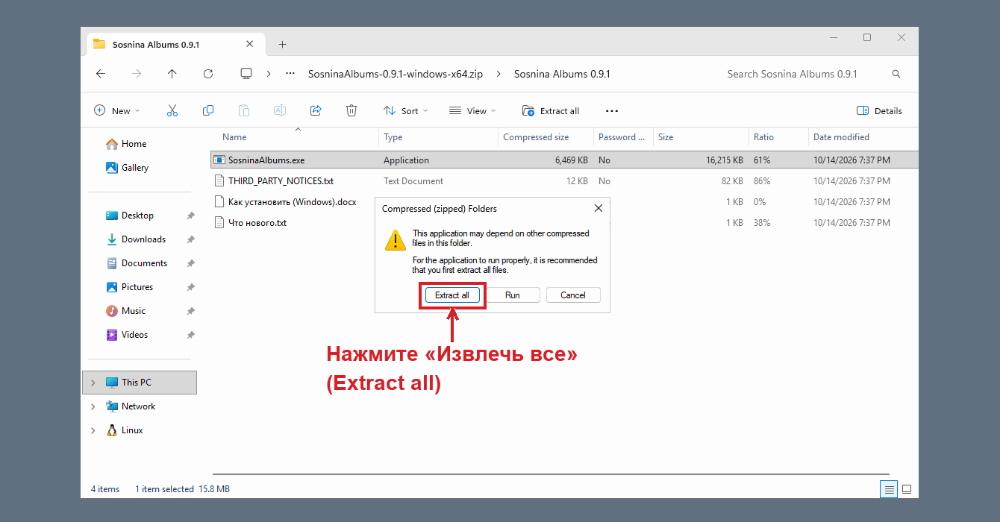

Ролик (без звука): [windows-fromzip.mp4](https://github.com/IliaSA101/sosninaalbums/raw/v{{VERSION}}/docs/install/video/windows-fromzip.mp4).

### Если кнопки «Выполнить в любом случае» нет

Ролик (без звука): [windows-unblock.mp4](https://github.com/IliaSA101/sosninaalbums/raw/v{{VERSION}}/docs/install/video/windows-unblock.mp4).

1. Лучше сделать это до распаковки: щёлкните по файлу `.zip` правой кнопкой мыши и выберите **«Свойства»**. (Если уже распаковали — так же по файлу `SosninaAlbums.exe`.)
2. На вкладке **«Общие»** внизу поставьте флажок **«Разблокировать»** и нажмите **«ОК»**.
   ~ **Путь:** правая кнопка по файлу → **«Свойства»** → вкладка **«Общие»** → внизу флажок **«Разблокировать»** → **«ОК»**.

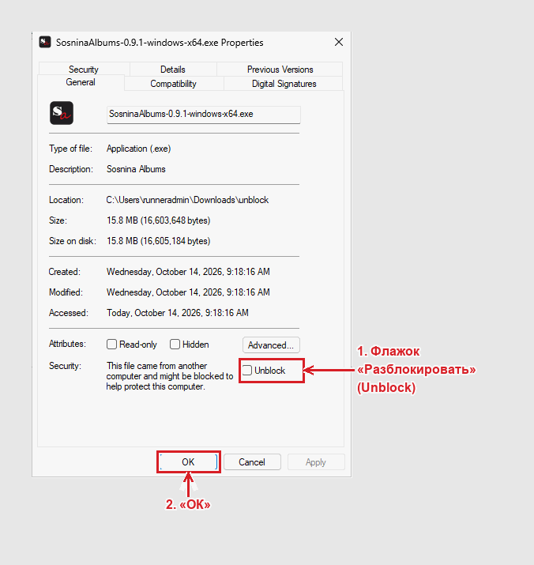

3. Если разблокировали архив — распакуйте его (шаг 2). Запустите программу двойным щелчком.

### Если программа просит WebView2

Программе нужен компонент Microsoft WebView2. В Windows 10 и 11 он обычно уже есть. Если его нет, программа сама предложит скачать его с сайта Microsoft — согласитесь и запустите программу ещё раз.

### Если ругается антивирус

Антивирусы иногда настороженно относятся к новым программам без подписи. Это ложное срабатывание. Разрешите запуск в окне антивируса или добавьте файл в исключения.

### Если всё равно не открылось — пришлите нам

Пришлите снимок окна с ошибкой и версию Windows (Пуск → **«Параметры»** → **«Система»** → **«О системе»**). Если программа хоть раз запускалась, приложите файл `log.txt` из папки `%APPDATA%\SosninaAlbums` (вставьте этот путь в адресную строку Проводника).

Куда прислать: тому, от кого вы получили программу, или на [страницу вопросов на GitHub](https://github.com/IliaSA101/sosninaalbums/issues).

Для специалистов: на Windows предупреждает SmartScreen. Он реагирует на отметку «скачано из интернета» у файла без платной подписи. Это поток `Zone.Identifier`, его снимает флажок «Разблокировать»; Проводник переносит отметку архива на всё, что из него извлечено.
<!-- /only -->

<!-- only: general, mac -->
## Mac

### Шаг 1. Распакуйте архив

<!-- only: general -->
Видео этого шага (около 25 секунд, без звука): macOS 15 — [mac-15-unzip.mp4](https://github.com/IliaSA101/sosninaalbums/raw/v{{VERSION}}/docs/install/video/mac-15-unzip.mp4), macOS 26 — [mac-26-unzip.mp4](https://github.com/IliaSA101/sosninaalbums/raw/v{{VERSION}}/docs/install/video/mac-26-unzip.mp4), macOS 12–14 — [mac-14-unzip.mp4](https://github.com/IliaSA101/sosninaalbums/raw/v{{VERSION}}/docs/install/video/mac-14-unzip.mp4).
<!-- /only -->
<!-- only: 15 -->
<!-- only: mac -->
Видео этого шага (около 25 секунд, без звука): [mac-15-unzip.mp4](https://github.com/IliaSA101/sosninaalbums/raw/v{{VERSION}}/docs/install/video/mac-15-unzip.mp4).
<!-- /only -->
<!-- /only -->
<!-- only: 26 -->
<!-- only: mac -->
Видео этого шага (около 25 секунд, без звука): [mac-26-unzip.mp4](https://github.com/IliaSA101/sosninaalbums/raw/v{{VERSION}}/docs/install/video/mac-26-unzip.mp4).
<!-- /only -->
<!-- /only -->
<!-- only: 12-14 -->
<!-- only: mac -->
Видео этого шага (около 25 секунд, без звука, снято на macOS 14): [mac-14-unzip.mp4](https://github.com/IliaSA101/sosninaalbums/raw/v{{VERSION}}/docs/install/video/mac-14-unzip.mp4).
<!-- /only -->
<!-- /only -->

1. Скачайте файл `.zip`.
2. Откройте папку **«Загрузки»** в Finder и дважды щёлкните по файлу `.zip`. Рядом появится папка «Sosnina Albums <версия>»: в ней программа **sosninaalbums**, инструкция и файл «Что нового». Откройте эту папку.
   ~ **Путь:** Finder (значок с улыбающимся лицом в Dock) → в левой колонке **«Загрузки»** → двойной щелчок по `.zip` → двойной щелчок по папке «Sosnina Albums <версия>».
3. Перетащите **sosninaalbums** в папку **«Программы»** (она есть в левой колонке окна Finder).
   ~ **Путь:** Finder → в левой колонке **«Программы»** — перетащите программу в это окно.

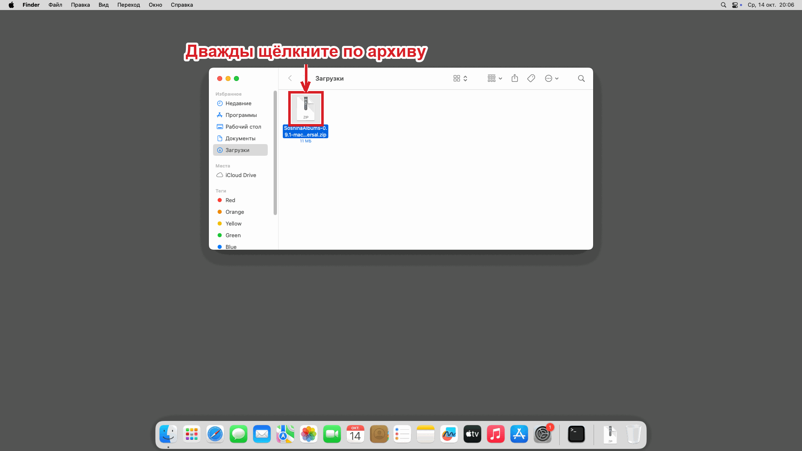

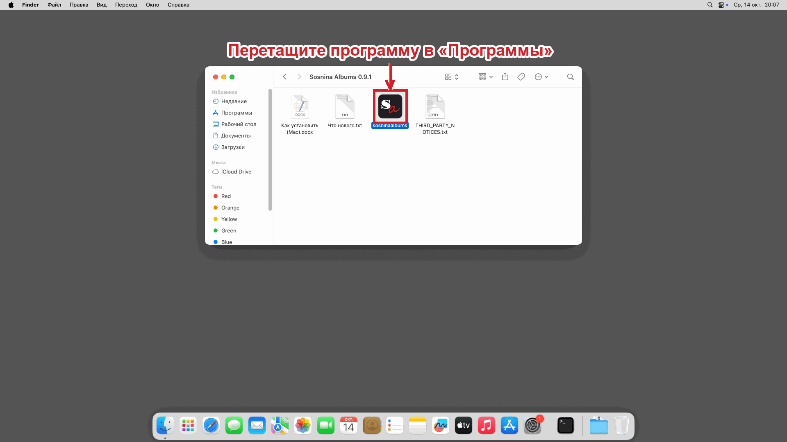

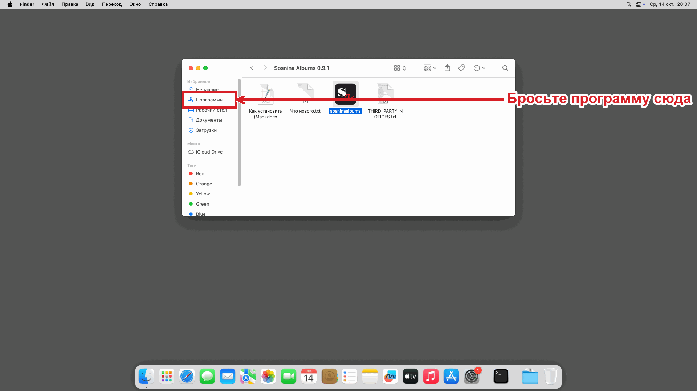

Так же поступайте, если архив прислали через Telegram или другой мессенджер.

### Шаг 2. Первый запуск

Сначала узнайте версию macOS: меню Apple (яблоко в левом верхнем углу экрана) → **«Об этом Mac»**. В окне будет, например, «macOS Sequoia 15.7». Названия версий: 12 — Monterey, 13 — Ventura, 14 — Sonoma, 15 — Sequoia, 26 — Tahoe.

На каждом снимке ниже красная рамка и стрелка показывают, куда нажимать. Если на экране то же окно — идите по стрелке.

<!-- only: general -->
#### macOS 15 (Sequoia) и 26 (Tahoe)

Видео этих шагов (около минуты, без звука): macOS 15 — [mac-15-start.mp4](https://github.com/IliaSA101/sosninaalbums/raw/v{{VERSION}}/docs/install/video/mac-15-start.mp4), macOS 26 — [mac-26-start.mp4](https://github.com/IliaSA101/sosninaalbums/raw/v{{VERSION}}/docs/install/video/mac-26-start.mp4).
<!-- /only -->
<!-- only: 15 -->
<!-- only: mac -->
Видео этих шагов (около минуты, без звука): [mac-15-start.mp4](https://github.com/IliaSA101/sosninaalbums/raw/v{{VERSION}}/docs/install/video/mac-15-start.mp4).
<!-- /only -->
<!-- /only -->
<!-- only: 26 -->
<!-- only: mac -->
Видео этих шагов (около минуты, без звука): [mac-26-start.mp4](https://github.com/IliaSA101/sosninaalbums/raw/v{{VERSION}}/docs/install/video/mac-26-start.mp4).
<!-- /only -->
<!-- /only -->

<!-- only: 15, 26 -->
1. Дважды щёлкните по **sosninaalbums** в папке «Программы». Появится окно «Файл „sosninaalbums“ не был открыт». Нажмите **«Готово»** — не «Переместить в Корзину».
   ~ **Путь:** Finder → **«Программы»** → **sosninaalbums** (двойной щелчок) → окно «не был открыт» → **«Готово»**.

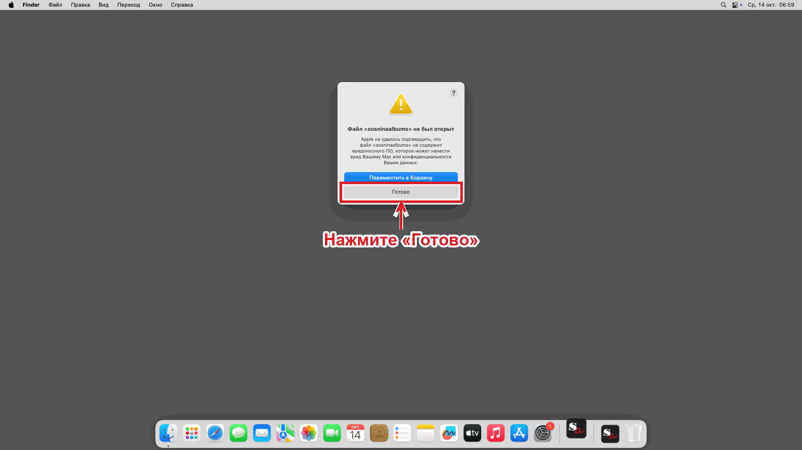

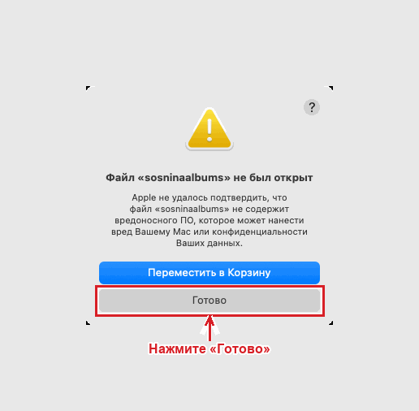

2. Откройте системные настройки: меню Apple (яблоко в левом верхнем углу) → **«Системные настройки…»**.
   ~ **Путь:** меню Apple → **«Системные настройки…»**.

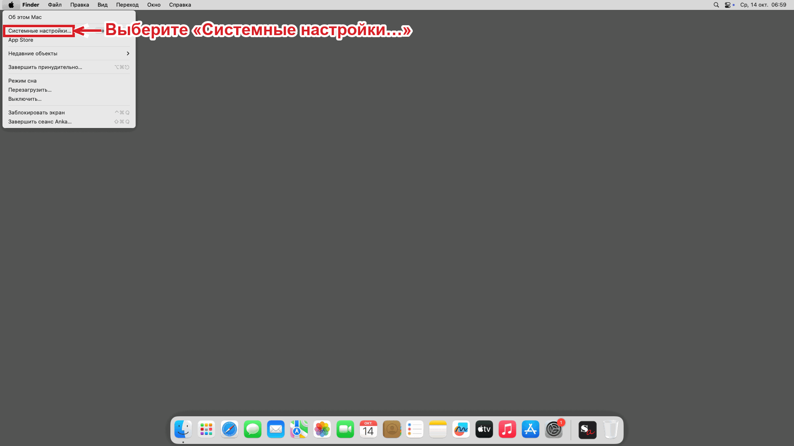

3. В левой колонке окна «Системные настройки» выберите **«Конфиденциальность и безопасность»**. Колонка длинная — прокрутите её вниз, нужный пункт ниже «Siri», «Spotlight» и «Обои».
   ~ **Путь:** меню Apple → **«Системные настройки…»** → в левой колонке **«Конфиденциальность и безопасность»**.

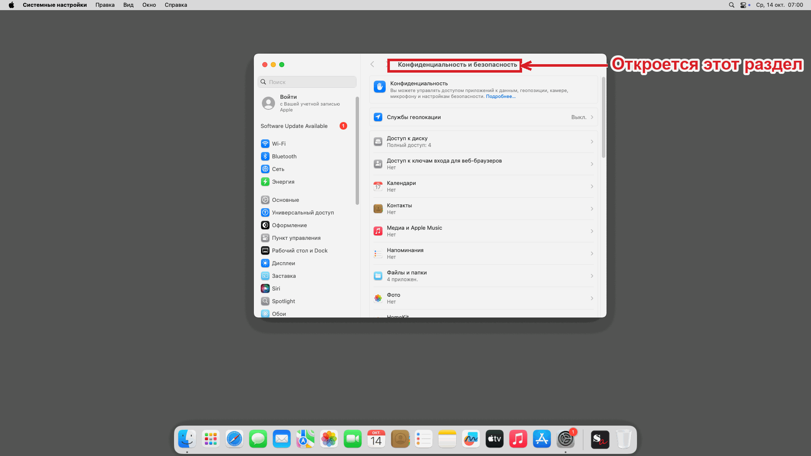

4. Прокрутите правую часть окна вниз до раздела **«Безопасность»**. Там будет строка «Файл „sosninaalbums“ заблокирован для защиты Вашего Mac». Нажмите рядом кнопку **«Все равно открыть»**.
<!-- only: general -->
   ~ **Путь, macOS 15:** меню Apple → **«Системные настройки…»** → **«Конфиденциальность и безопасность»** → прокрутить правую часть вниз → раздел **«Безопасность»** → **«Все равно открыть»**.
   ~ **Путь, macOS 26:** тот же. Окно выглядит круглее, а левая колонка — отдельная панель; надписи и порядок те же (второй снимок ниже).
<!-- /only -->
<!-- only: 15, 26 -->
<!-- only: mac -->
   ~ **Путь:** меню Apple → **«Системные настройки…»** → **«Конфиденциальность и безопасность»** → прокрутить правую часть вниз → раздел **«Безопасность»** → **«Все равно открыть»**.
<!-- /only -->
<!-- /only -->

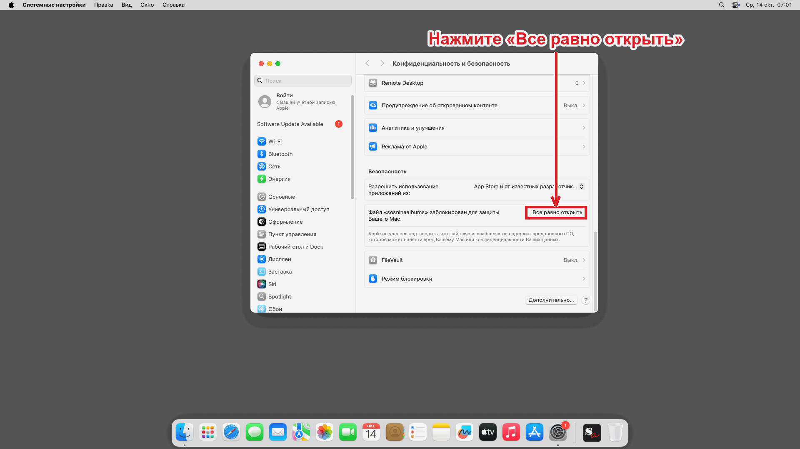

<!-- only: general -->
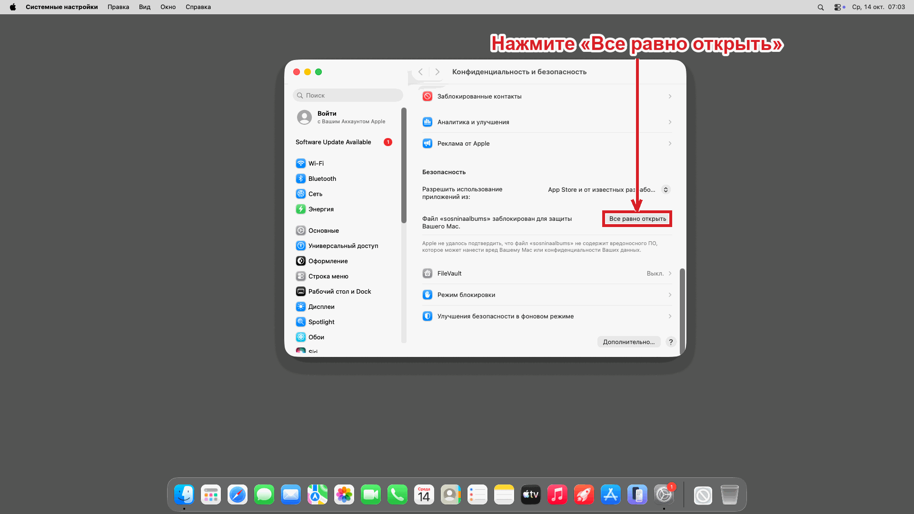
<!-- /only -->

5. Появится окно «Открыть файл „sosninaalbums“?». Нажмите в нём **«Все равно открыть»** — среднюю кнопку, не «Переместить в Корзину».
   ~ **Путь:** окно «Открыть файл „sosninaalbums“?» → **«Все равно открыть»**.

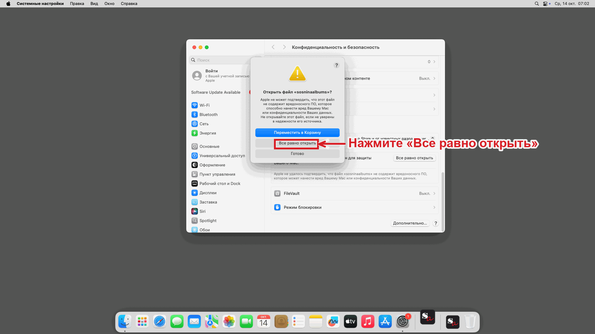

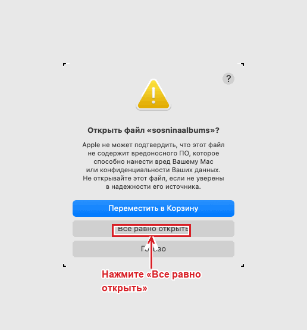

6. Введите пароль от Mac (или приложите палец к Touch ID). Программа откроется, и в следующий раз будет открываться сразу.

Кнопка «Все равно открыть» в настройках видна примерно час после попытки запуска. Если её нет, снова дважды щёлкните по программе, нажмите «Готово» и вернитесь в настройки.
<!-- /only -->

<!-- only: general -->
#### macOS 12, 13 и 14
<!-- /only -->

<!-- only: 12-14 -->
<!-- only: mac -->
Видео этих шагов (около 25 секунд, без звука, снято на macOS 14): [mac-14-start.mp4](https://github.com/IliaSA101/sosninaalbums/raw/v{{VERSION}}/docs/install/video/mac-14-start.mp4).
<!-- /only -->

1. Откройте папку «Программы» и щёлкните по **sosninaalbums** правой кнопкой мыши (или с нажатой клавишей Control).
   ~ **Путь:** Finder → **«Программы»** → **sosninaalbums** → правая кнопка мыши → **«Открыть»**.

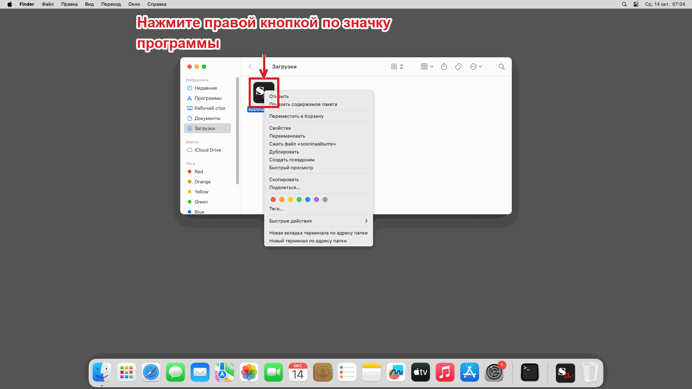

2. Выберите **«Открыть»**.
3. В появившемся окне снова нажмите **«Открыть»**. Программа откроется, и в следующий раз будет открываться сразу.

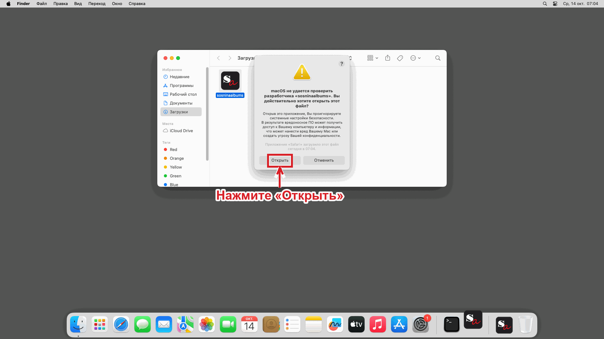

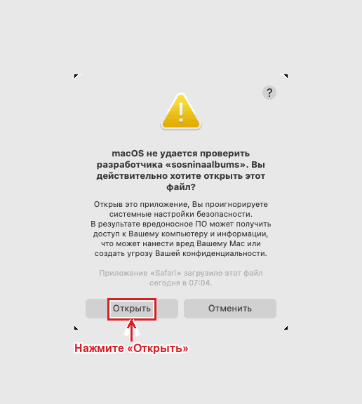

Если в окне нет кнопки «Открыть», разрешите запуск в настройках:

1. Один раз попробуйте открыть программу двойным щелчком и закройте окно с отказом кнопкой **«OK»**.

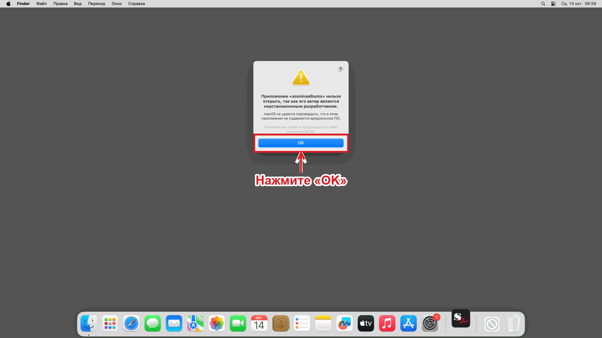

2. macOS 13 и 14: меню Apple → **«Системные настройки…»** → **«Конфиденциальность и безопасность»** → прокрутить вниз → **«Безопасность»** → **«Все равно открыть»**.

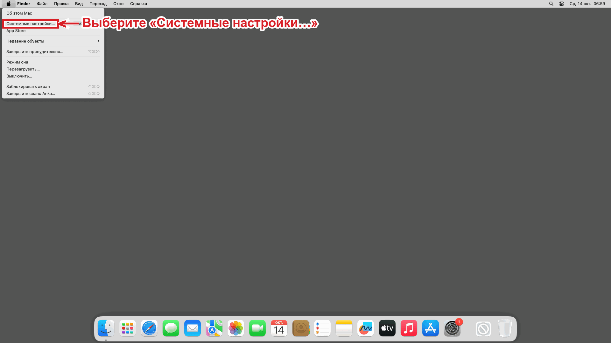

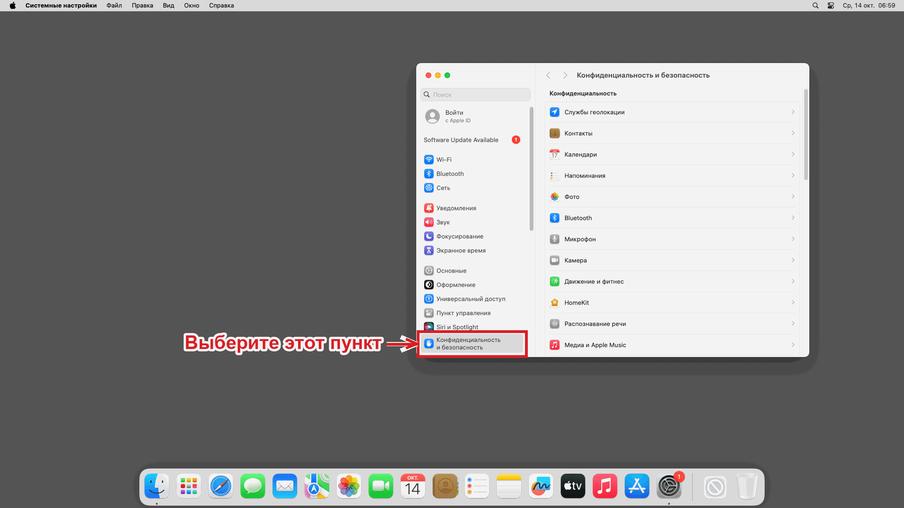

3. macOS 12: меню Apple → **«Системные настройки…»** → **«Защита и безопасность»** → вкладка **«Основные»** → **«Все равно открыть»**.
<!-- /only -->
<!-- only: general -->

Видео шагов для macOS 12–14 (около 25 секунд, без звука, снято на macOS 14): [mac-14-start.mp4](https://github.com/IliaSA101/sosninaalbums/raw/v{{VERSION}}/docs/install/video/mac-14-start.mp4).
<!-- /only -->

### Если пишет «повреждено» или программа не открывается

Это бывает с файлами из интернета и мессенджеров. Помогает одна команда в программе «Терминал» (по-английски Terminal).

<!-- only: general -->
Видео (около 40 секунд, без звука): macOS 15 — [mac-15-damaged.mp4](https://github.com/IliaSA101/sosninaalbums/raw/v{{VERSION}}/docs/install/video/mac-15-damaged.mp4), macOS 26 — [mac-26-damaged.mp4](https://github.com/IliaSA101/sosninaalbums/raw/v{{VERSION}}/docs/install/video/mac-26-damaged.mp4), macOS 12–14 — [mac-14-damaged.mp4](https://github.com/IliaSA101/sosninaalbums/raw/v{{VERSION}}/docs/install/video/mac-14-damaged.mp4).
<!-- /only -->
<!-- only: 15 -->
<!-- only: mac -->
Видео (около 40 секунд, без звука): [mac-15-damaged.mp4](https://github.com/IliaSA101/sosninaalbums/raw/v{{VERSION}}/docs/install/video/mac-15-damaged.mp4).
<!-- /only -->
<!-- /only -->
<!-- only: 26 -->
<!-- only: mac -->
Видео (около 40 секунд, без звука): [mac-26-damaged.mp4](https://github.com/IliaSA101/sosninaalbums/raw/v{{VERSION}}/docs/install/video/mac-26-damaged.mp4).
<!-- /only -->
<!-- /only -->
<!-- only: 12-14 -->
<!-- only: mac -->
Видео (около 40 секунд, без звука, снято на macOS 14): [mac-14-damaged.mp4](https://github.com/IliaSA101/sosninaalbums/raw/v{{VERSION}}/docs/install/video/mac-14-damaged.mp4).
<!-- /only -->
<!-- /only -->

1. Откройте «Терминал» (по-английски Terminal): Finder → «Программы» → «Утилиты» → **«Терминал»**. Или нажмите Command + Пробел, наберите «Терминал» (на английской macOS — Terminal) и нажмите Return.
   ~ **Путь:** Finder → **«Программы»** → **«Утилиты»** → **«Терминал»**.
2. Скопируйте команду, вставьте её в окно «Терминала» (Command + V) и нажмите Return:

```
xattr -dr com.apple.quarantine /Applications/sosninaalbums.app
```

3. Команда ничего не выводит — так и должно быть. Если программа лежит не в «Программах», наберите `xattr -dr com.apple.quarantine ` (с пробелом в конце), перетащите **sosninaalbums** из Finder в окно «Терминала» — путь подставится сам — и нажмите Return.

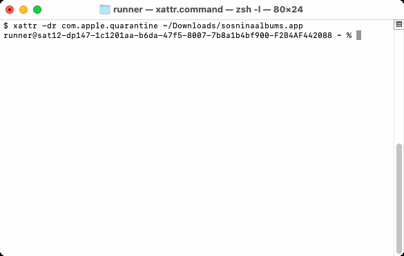

4. Дважды щёлкните по **sosninaalbums** в папке «Программы». Программа откроется.
   ~ **Путь:** Finder → **«Программы»** → **sosninaalbums** (двойной щелчок).

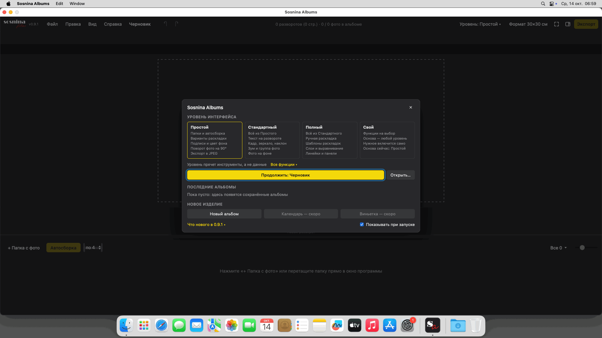

### Видео

Короткие ролики без звука. На каждом шаге ролик останавливается, а красная рамка и стрелка показывают, куда нажать.

<!-- only: general, 15 -->
- macOS 15, распаковка (около 25 секунд): [mac-15-unzip.mp4](https://github.com/IliaSA101/sosninaalbums/raw/v{{VERSION}}/docs/install/video/mac-15-unzip.mp4)
- macOS 15, первый запуск (около минуты): [mac-15-start.mp4](https://github.com/IliaSA101/sosninaalbums/raw/v{{VERSION}}/docs/install/video/mac-15-start.mp4)
- macOS 15, если пишет «повреждено» (около 40 секунд): [mac-15-damaged.mp4](https://github.com/IliaSA101/sosninaalbums/raw/v{{VERSION}}/docs/install/video/mac-15-damaged.mp4)
<!-- /only -->
<!-- only: general, 26 -->
- macOS 26, распаковка (около 25 секунд): [mac-26-unzip.mp4](https://github.com/IliaSA101/sosninaalbums/raw/v{{VERSION}}/docs/install/video/mac-26-unzip.mp4)
- macOS 26, первый запуск (около минуты): [mac-26-start.mp4](https://github.com/IliaSA101/sosninaalbums/raw/v{{VERSION}}/docs/install/video/mac-26-start.mp4)
- macOS 26, если пишет «повреждено» (около 40 секунд): [mac-26-damaged.mp4](https://github.com/IliaSA101/sosninaalbums/raw/v{{VERSION}}/docs/install/video/mac-26-damaged.mp4)
<!-- /only -->
<!-- only: general, 12-14 -->
- macOS 12–14, распаковка (около 25 секунд, снято на macOS 14): [mac-14-unzip.mp4](https://github.com/IliaSA101/sosninaalbums/raw/v{{VERSION}}/docs/install/video/mac-14-unzip.mp4)
- macOS 12–14, первый запуск (около 25 секунд, снято на macOS 14): [mac-14-start.mp4](https://github.com/IliaSA101/sosninaalbums/raw/v{{VERSION}}/docs/install/video/mac-14-start.mp4)
- macOS 12–14, если пишет «повреждено» (около 40 секунд): [mac-14-damaged.mp4](https://github.com/IliaSA101/sosninaalbums/raw/v{{VERSION}}/docs/install/video/mac-14-damaged.mp4)
<!-- /only -->
<!-- only: both -->
- Windows, распаковка: [windows-unzip.mp4](https://github.com/IliaSA101/sosninaalbums/raw/v{{VERSION}}/docs/install/video/windows-unzip.mp4)
- Windows, первый запуск: [windows-start.mp4](https://github.com/IliaSA101/sosninaalbums/raw/v{{VERSION}}/docs/install/video/windows-start.mp4)
- Windows, если запустили прямо из архива: [windows-fromzip.mp4](https://github.com/IliaSA101/sosninaalbums/raw/v{{VERSION}}/docs/install/video/windows-fromzip.mp4)
- Windows, если нет кнопки «Выполнить в любом случае»: [windows-unblock.mp4](https://github.com/IliaSA101/sosninaalbums/raw/v{{VERSION}}/docs/install/video/windows-unblock.mp4)
<!-- /only -->

### Если всё равно не открылось — пришлите нам

Откройте «Терминал» (как выше), выполните по очереди четыре команды и пришлите их вывод — текстом или снимком экрана:

```
xattr -l /Applications/sosninaalbums.app
/Applications/sosninaalbums.app/Contents/MacOS/sosninaalbums
codesign -dv --verbose=2 /Applications/sosninaalbums.app
spctl -a -vv /Applications/sosninaalbums.app
```

Вторая команда запускает программу прямо из «Терминала» и показывает текст ошибки. Если программа открылась — закройте её.

Добавьте версию macOS и модель Mac: меню Apple → **«Об этом Mac»**. Если программа хоть раз запускалась, приложите файл `log.txt` из папки `~/Library/Application Support/SosninaAlbums` (в Finder: меню «Переход» → «Переход к папке…», вставьте этот путь).

Куда прислать: тому, от кого вы получили программу, или на [страницу вопросов на GitHub](https://github.com/IliaSA101/sosninaalbums/issues).

Для специалистов: на Mac предупреждает Gatekeeper. Он реагирует на отметку «скачано из интернета» у файла без платной подписи (Apple Developer ID с нотаризацией). Это атрибут `com.apple.quarantine`, его снимает `xattr -dr`.
<!-- /only -->

<!-- only: win, mac, macos -->
## Обновление

Новая версия — новая папка: скачайте и распакуйте новый архив так же, как в первый раз. Старую папку (на Mac — старую программу в «Программах») можно удалить, когда новая откроется. Альбомы (файлы `.salbum`), шаблоны и настройки не пропадут: шаблоны и настройки лежат в папке данных пользователя, а не рядом с программой.
<!-- /only -->

<!-- only: linux -->
## Linux

### Вариант 1. Пакет .deb (Ubuntu, Mint, Debian)

Подходит Ubuntu 22.04 и новее, Linux Mint 21 и новее, Debian 12 и новее.

1. На странице выпусков скачайте файл `SosninaAlbums-<версия>-linux-amd64.deb`. Браузер сохранит его в папку «Загрузки».
2. Откройте файл двойным щелчком: запустится «Установка приложений» или «Менеджер программ». Нажмите **«Установить»** и введите пароль. Недостающие библиотеки (GTK 3 и WebKitGTK 4.1) система поставит сама.
3. Либо в «Терминале»: `sudo apt install ./SosninaAlbums-<версия>-linux-amd64.deb`. Точку и косую черту перед именем файла не убирайте: без них `apt` ищет пакет в интернете, а не в папке.
4. Запустите программу из меню приложений: «Sosnina Albums» в разделе «Графика». Из «Терминала» — командой `sosninaalbums`.

### Вариант 2. Архив .tar.gz (другие дистрибутивы)

1. Скачайте `SosninaAlbums-<версия>-linux-amd64.tar.gz` и распакуйте его в любую папку: в файловом менеджере **«Распаковать»**, либо `tar -xzf SosninaAlbums-<версия>-linux-amd64.tar.gz`.
2. Из вашего дистрибутива нужны библиотеки GTK 3 и WebKitGTK 4.1. Названия пакетов: `libgtk-3-0` и `libwebkit2gtk-4.1-0` (Debian, Ubuntu), `gtk3` и `webkit2gtk-4.1` (Fedora, Arch).
3. Откройте папку «Sosnina Albums <версия>» и запустите файл `sosninaalbums` двойным щелчком или из «Терминала»: `./sosninaalbums`. Если файловый менеджер предлагает открыть файл в текстовом редакторе, в его настройках включите запуск исполняемых файлов.
4. Запускайте программу из распакованной папки, а не из окна архива.

### Где лежат данные

Альбомы (файлы `.salbum`) вы сохраняете сами, куда выберете. Остальное программа держит в вашей домашней папке:

| Что                                         | Где                                             |
| ------------------------------------------- | ----------------------------------------------- |
| Настройки, шаблоны, черновик, журнал `log.txt`, свои шрифты | `~/.config/SosninaAlbums`       |
| Миниатюры (можно удалить, пересоздаются)    | `~/.cache/SosninaAlbums`                        |
| Резервные копии альбомов                    | `~/.local/share/SosninaAlbums/backups`          |

Если в вашей системе заданы `XDG_CONFIG_HOME`, `XDG_CACHE_HOME` или `XDG_DATA_HOME`, вместо `~/.config`, `~/.cache` и `~/.local/share` берутся они.

### Обновление

Скачайте новую версию и поставьте так же, как в первый раз: `.deb` ставится поверх прежней, архив распакуйте в новую папку, а старую удалите, когда новая откроется. Настройки и шаблоны лежат в домашней папке и не пропадают.

### Удаление

Пакет: `sudo apt remove sosninaalbums`. Архив: удалите папку. Настройки и миниатюры останутся в домашней папке, их можно удалить вручную (см. таблицу выше).

### Если программа не запускается

Запустите её из «Терминала» (`sosninaalbums` или `./sosninaalbums`): там будет текст ошибки. Самая частая причина — нет библиотек GTK 3 или WebKitGTK 4.1 (для архива `.tar.gz`).

Если не помогло, пришлите вывод «Терминала», название и версию дистрибутива (`lsb_release -a`) и файл `~/.config/SosninaAlbums/log.txt` на [страницу вопросов на GitHub](https://github.com/IliaSA101/sosninaalbums/issues): кнопка «Сообщить о проблеме» в окне «О программе» откроет готовую форму. Личные фото и пути к ним не прикладывайте.
<!-- /only -->
